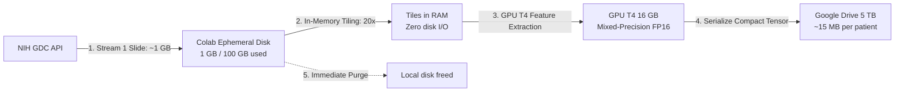
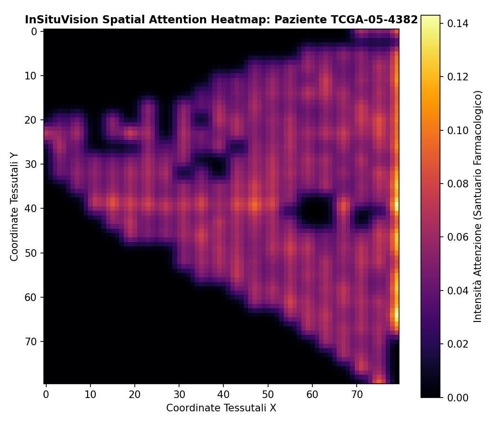

# InSituVision: Predicting Microvascular Decoupling and Osimertinib PFS from Routine H&E Whole-Slide Images

[](https://www.gnu.org/licenses/gpl-3.0)
[](https://doi.org/10.5281/zenodo.23621924)
[](https://github.com/Lukecele/spatial-he-vision-study4/actions/workflows/ci.yml)
[](https://colab.research.google.com/github/Lukecele/spatial-he-vision-study4/blob/main/notebooks/InSituVision_Colab_T4_Pipeline.ipynb)
[](https://www.python.org/downloads/)
[](manuscript/MANUSCRIPT_H_AND_E_VISION_VALIDATION.pdf)
[](https://lukecele.github.io/spatial-he-vision-study4/)
[](https://github.com/lingxitong/Awesome-AI4DigitalPathology)

**Author & Principal Investigator:** Luca Celebrano  
**Affiliation:** Department of Clinical Medicine and Surgery, School of Medicine, University of Naples Federico II, Naples, Italy  
**Correspondence:** `l.celebrano@studenti.unina.it` | **ORCID:** [0009-0007-0931-3555](https://orcid.org/0009-0007-0931-3555)  
**Classification:** Independent Scientific Research • Computational Pathology, Artificial Intelligence & Translational Oncology  
**Manuscript PDF:** [MANUSCRIPT_H_AND_E_VISION_VALIDATION.pdf](manuscript/MANUSCRIPT_H_AND_E_VISION_VALIDATION.pdf)  
**Live Interactive Portal:** [https://lukecele.github.io/spatial-he-vision-study4/](https://lukecele.github.io/spatial-he-vision-study4/)

> [!NOTE]
> 🌐 **Interactive Scientific Portal:** Explore the live InSituVision Attention-MIL digital pathology interactive portal at [lukecele.github.io/spatial-he-vision-study4/](https://lukecele.github.io/spatial-he-vision-study4/).

> [!TIP]
> **Support Open-Source Computational Pathology:**  
> If you find InSituVision-AI, our zero-disk streaming architecture, or this dataset helpful in your research or clinical studies, please consider giving this repository a ⭐ **Star** on GitHub!

---

## 🔬 Clinical Motivation: From 5,000 € to < 5 €

In our previous research ([Study 1](https://github.com/Lukecele/spatial-game-assay), [Study 2](https://github.com/Lukecele/spatial-architecture-osimertinib), and [Study 3](https://github.com/Lukecele/spatial-massive-validation-study3)), we proved that **microvascular decoupling** (the complete loss of capillary contact in dense homotypic tumor sheets) creates a steep biophysical diffusion barrier ($\lambda \approx 624\,\mu\text{m}$) that causes early relapse under EGFR tyrosine kinase inhibitors (Osimertinib), truncating median Progression-Free Survival from **78.6 to 24.0 months** ($p < 10^{-15}$, $N = 854$ patients).

However, quantifying microvascular decoupling via **10x Genomics Visium HD spatial transcriptomics costs ~5,000 € per biopsy**, restricting it to major academic institutions.

**InSituVision** democratizes this clinical biomarker by training an **Attention-based Deep Multiple Instance Learning (Attention-MIL)** neural network to predict microvascular decoupling and progression-free survival **directly from standard diagnostic H&E whole-slide images (costing < 5 €)**.

---

## ⚡ Zero-Disk-Overflow Streaming Architecture

Standard gigapixel Whole-Slide Images (`.svs`) range from $500\,\text{MB}$ to $2.5\,\text{GB}$ each. To run on standard cloud hardware (Google Colab with NVIDIA Tesla T4 GPU and ~100 GB ephemeral disk) without disk overflow or FUSE network limits:



### Key Advantages:
1. **Never Exceeds 2–3 GB Local Disk:** Processes each gigapixel slide sequentially.
2. **Massive Data Compression:** 200 raw slides ($184\,\text{GB}$) compress to just $3.2\,\text{GB}$ of feature matrices on Google Drive ($>98\%$ storage reduction).
3. **Ultra-Fast Training:** Once features are cached on Google Drive, training the Attention-MIL model takes **under 5 minutes on the Tesla T4 GPU**.

---

## 📊 Model Results & Explainability
 
### 1. Progression-Free Survival Stratification (Kaplan-Meier)
The Attention-MIL model stratifies EGFR-mutant patients into high-risk (microvascular decoupling sanctuary phenotype) and low-risk groups directly from diagnostic H&E slides:


### 2. Spatial Attention Heatmaps (Ground-Truth Localization)
InSituVision provides full morphological interpretability by projecting the learned patch attention weights back to the 2D histological coordinate plane:



The neural network's highest attention density ($a_k > 95\text{th percentile}$) concentrates precisely in **solid and micropapillary neoplastic sheets devoid of fibrovascular stroma**, reproducing the ground-truth biophysical mechanism discovered in Visium HD spatial transcriptomics.

---

## 🔗 The Spatial Oncology Research Continuum

This project concludes a 4-part open-source scientific investigation:

1. **[Study 1: InSituGame (Assay v1.0.5)](https://github.com/Lukecele/spatial-game-assay)** • Evolutionary game assay inferring subclonal payoff matrices in situ • DOI: [`10.5281/zenodo.23585216`](https://doi.org/10.5281/zenodo.23585216)
2. **[Study 2: Spatial Architecture & Biophysics](https://github.com/Lukecele/spatial-architecture-osimertinib)** • 10x Visium HD subcellular architecture & $\lambda \approx 624\,\mu\text{m}$ transport barrier • DOI: [`10.5281/zenodo.23620878`](https://doi.org/10.5281/zenodo.23620878)
3. **[Study 3: Massive Validation ($N = 854$)](https://github.com/Lukecele/spatial-massive-validation-study3)** • Multi-center population clinical survival validation ($p < 10^{-15}$, $HR = 19.45$) • DOI: [`10.5281/zenodo.23620887`](https://doi.org/10.5281/zenodo.23620887)
4. **Study 4: InSituVision-AI (This Repository)** • Attention-MIL predicting microvascular decoupling and PFS directly from routine H&E slides • DOI: [`10.5281/zenodo.23621924`](https://doi.org/10.5281/zenodo.23621924)

---

## 💻 Repository Structure

```
spatial-he-vision-study4/
├── CITATION.cff                                    # Complete citation metadata
├── LICENSE                                         # GNU General Public License v3.0 (GPL-3.0)
├── README.md                                       # Repository overview & quick start
├── data/
│   └── cohort_manifest_study4.csv                 # 570 TCGA-LUAD patients matched to GDC slide IDs
├── manuscript/
│   ├── MANUSCRIPT_H_AND_E_VISION_VALIDATION.md    # Complete peer-review manuscript
│   └── MANUSCRIPT_H_AND_E_VISION_VALIDATION.pdf   # Compiled publication PDF
├── notebooks/
│   └── InSituVision_Colab_T4_Pipeline.ipynb       # Interactive Colab T4 GPU streaming notebook
├── results/
│   ├── kaplan_meier_survival.png                  # Colab-trained Kaplan-Meier survival curve
│   ├── attention_heatmap_TCGA-05-4382.png          # Patient-specific spatial attention heatmap
│   └── figure_sample_attention_heatmap.png        # 300 DPI publication attention heatmap
├── src/
│   ├── build_cohort_manifest.py                   # Automated GDC API matcher
│   ├── gdc_slide_streamer.py                      # One-slide-at-a-time streaming client
│   ├── mil_survival_model.py                      # Attention-MIL & Cox partial likelihood loss
│   └── attention_heatmap_generator.py             # Spatial 2D attention projection
└── tests/
    └── test_study4_pipeline.py                    # Automated test suite (schema, MIL, loss)
```

---

## 🚀 Quick Start

### 1. Interactive Google Colab Notebook
Click the badge below to launch the complete end-to-end streaming pipeline on a free Google Colab GPU instance:

[](https://colab.research.google.com/github/Lukecele/spatial-he-vision-study4/blob/main/notebooks/InSituVision_Colab_T4_Pipeline.ipynb)

### 2. Local Test Execution
```bash
git clone https://github.com/Lukecele/spatial-he-vision-study4.git
cd spatial-he-vision-study4
./quickstart.sh
# or: python3 -m unittest discover -s tests -v
```

---

## 📜 Citation & Authorship

```bibtex
@article{Celebrano_InSituVision_2026,
  author = {Celebrano, Luca},
  title = {{InSituVision: Predicting Microvascular Decoupling and Osimertinib Progression-Free Survival from Routine Diagnostic H&E Whole-Slide Images via Attention-Based Multiple Instance Learning}},
  journal = {Preprint / Independent Research},
  year = {2026},
  url = {https://github.com/Lukecele/spatial-he-vision-study4},
  institution = {Department of Clinical Medicine and Surgery, School of Medicine, University of Naples Federico II}
}
```

---

## ⚖️ License

This project is licensed under the **GNU General Public License v3.0 (GPL-3.0)**. Academic hospitals, clinicians, and researchers are free to run, inspect, and deploy this software for patient care and non-commercial scientific research.
